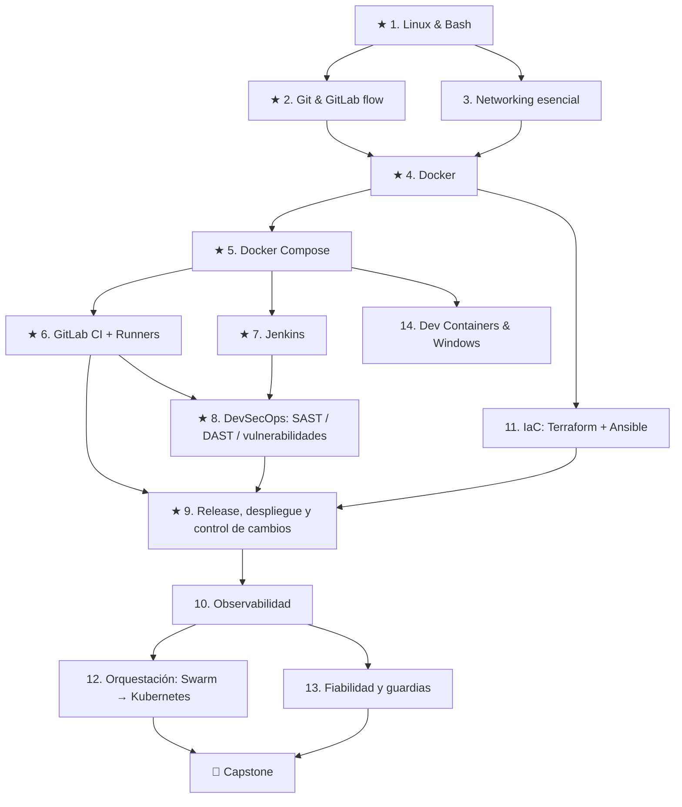

# DevOps / SRE Roadmap — Práctica estilo NeetCode

Objetivo: llegar a la entrevista (DevOps / SRE Mid, equipo IT interno, modernización de aplicaciones) habiendo **hecho** cada cosa del stack, no solo leído sobre ella. Cada nodo del árbol tiene labs de dificultad creciente, un criterio de "terminado", la pregunta de entrevista que suele salir y el estándar o patrón a dominar.

Spec pensado para trabajarse con Claude Code: un repo, una app que crece, un lab por rama/MR.

---

## 0. Cómo usar este roadmap

- **Dificultad:** 🟢 Easy (fundamento) · 🟡 Medium (lo que se hace en el trabajo) · 🔴 Hard (lo que te diferencia).
- **Regla de avance:** no pasás a un nodo hasta tener los 🟢 y 🟡 de sus padres. Los 🔴 se pueden dejar para la segunda vuelta.
- **Cada lab termina con tres cosas:** código en el repo, un "Done when" verificado, y 3–5 líneas en `docs/labs/<nodo>.md` explicando **qué decidiste y por qué**. Eso último es lo que vas a contar en la entrevista.
- **Prioridad:** los nodos marcados ★ son el stack imprescindible de la oferta. Si el tiempo es corto, recorré solo el camino ★ (ver sección 6).

---

## 1. El árbol



### Progreso

| Nodo | 🟢 | 🟡 | 🔴 |
|---|---|---|---|
| 1. Linux & Bash ★ | ☐ | ☐ | ☐ |
| 2. Git & GitLab flow ★ | ☐ | ☐ | ☐ |
| 3. Networking esencial | ☐ | ☐ | ☐ |
| 4. Docker ★ | ☐ | ☐ | ☐ |
| 5. Docker Compose ★ | ☐ | ☐ | ☐ |
| 6. GitLab CI + Runners ★ | ☐ | ☐ | ☐ |
| 7. Jenkins ★ | ☐ | ☐ | ☐ |
| 8. DevSecOps ★ | ☐ | ☐ | ☐ |
| 9. Release y cambios ★ | ☐ | ☐ | ☐ |
| 10. Observabilidad | ☐ | ☐ | ☐ |
| 11. Terraform + Ansible | ☐ | ☐ | ☐ |
| 12. Swarm → Kubernetes | ☐ | ☐ | ☐ |
| 13. Fiabilidad y guardias | ☐ | ☐ | ☐ |
| 14. Dev Containers & Windows | ☐ | ☐ | ☐ |
| 🏁 Capstone | ☐ | | |

---

## 2. Entorno y costos

### Dónde corre cada cosa

| Pieza | Dónde | Por qué |
|---|---|---|
| Repo + pipelines | **GitLab.com (plan gratuito)** | No hace falta levantar GitLab: es pesado y no es lo que evalúan. |
| GitLab Runner | **Self-hosted, en tu Mac con Docker** | Registrar y operar tu propio runner es justamente lo que pide la oferta. |
| Jenkins | **Local, en Docker** | Controller + agente en contenedores. |
| Servidor de despliegue "producción" | **GCP e2-micro (Always Free)** | Un Linux real, accesible por SSH, como destino de Ansible y de los deploys. |
| Terraform | **GCP** (y opcionalmente AWS) | Crear y destruir el servidor desde código. |
| Escáneres de seguridad | Contenedores locales / jobs del pipeline | Todas las herramientas son open source. |

### Reglas de costo (no negociables)

- **Antes de crear nada:** alerta de presupuesto de 1€ en GCP (Billing → Budgets) y en AWS (AWS Budgets).
- **Solo recursos dentro del nivel gratuito:** en GCP, una única VM e2-micro en `us-central1`, `us-west1` o `us-east1`, con disco estándar. Nada de load balancers, NAT gateways ni IPs estáticas sin usar: son las fuentes típicas de sorpresas en la factura.
- **AWS:** las condiciones del nivel gratuito cambiaron para cuentas nuevas en 2025 (créditos con vencimiento en vez de 12 meses de t2/t3.micro). Revisá en la consola qué te corresponde antes de usarla. AWS es opcional en este roadmap.
- **Todo lo que crea Terraform se destruye al terminar cada sesión** (`terraform destroy`), salvo el servidor del capstone.
- **La clave de la cuenta de servicio no se descarga:** autenticación con `gcloud auth application-default login` en local y OIDC desde GitLab (nodo 8).

---

## 3. La app de práctica: `tasks-api`

Una app chica pero realista, para que los pipelines tengan algo de verdad que construir, testear y escanear.

- **API:** Python + FastAPI, CRUD de tareas, endpoints `/health` y `/ready` (el segundo verifica la base de datos), endpoint `/metrics` en formato Prometheus.
- **Base de datos:** PostgreSQL.
- **Reverse proxy:** nginx.
- **Tests:** pytest con cobertura.
- **Configuración:** solo por variables de entorno (12-factor). Ningún secreto en el repo.

Estructura objetivo del repo:

```
tasks-api/
├── app/                  # código de la API
├── tests/
├── docker/
│   ├── Dockerfile
│   └── nginx.conf
├── compose.yaml
├── compose.prod.yaml
├── .gitlab-ci.yml
├── Jenkinsfile
├── infra/
│   ├── terraform/
│   └── ansible/
├── scripts/              # bash: deploy, backup, rollback, healthcheck
├── .devcontainer/
└── docs/
    ├── labs/             # notas de cada lab
    ├── runbooks/
    └── adr/              # decisiones de arquitectura
```

---

## 4. Los nodos

### ★ 1. Linux & Bash

**Lo esencial:** procesos y señales, systemd, permisos y usuarios, logs (`journalctl`), uso de disco y memoria, scripting defensivo.

- 🟢 **Script de health check.** `scripts/healthcheck.sh` que consulta `/health` con reintentos y timeout, y sale con código 0 o 1.
  *Done when:* devuelve 1 con la API caída y 0 con la API arriba, y usa `set -euo pipefail`.
- 🟡 **Diagnóstico de servidor.** `scripts/diag.sh` que muestra en un reporte: carga y CPU, memoria (distinguiendo cache), discos al 80% o más, servicios systemd caídos y los últimos errores del journal.
  *Done when:* corre sin argumentos en el e2-micro y el reporte entra en una pantalla.
- 🔴 **Servicio con systemd.** La API corriendo como servicio systemd con usuario sin privilegios, reinicio automático y límites de memoria.
  *Done when:* matás el proceso con `kill -9` y systemd lo levanta solo.

**Pregunta de entrevista:** "El servidor está lento, ¿qué mirás primero?" → load average contra cantidad de cores, memoria y swap, disco (espacio e I/O), y después logs del servicio.
**Estándar:** todo script empieza con `set -euo pipefail`, valida sus argumentos y pasa ShellCheck sin advertencias.

---

### ★ 2. Git & GitLab flow

**Lo esencial:** ramas cortas, merge requests, ramas protegidas, revisiones obligatorias, tags semánticos.

- 🟢 **Reglas del repo.** `main` protegida (sin push directo), merge solo con pipeline en verde y al menos una aprobación.
- 🟡 **Convención de commits.** Conventional Commits validado en el pipeline (un job que falla si el mensaje no cumple).
- 🔴 **Versionado automático.** Al mergear en `main` se genera el tag semántico y el changelog a partir de los commits.

**Pregunta:** "¿Trunk-based o GitFlow?" → trunk-based con ramas cortas y feature flags para equipos que despliegan seguido; GitFlow solo si hay releases programados con varias versiones vivas.
**Estándar:** nada llega a `main` sin MR, pipeline verde y revisión.

---

### 3. Networking esencial

**Lo esencial:** DNS, puertos, TLS, cómo viaja una petición de punta a punta.

- 🟢 **Recorrido de una petición.** Documentar con comandos reales (`dig`, `curl -v`, `ss -tulpn`) qué pasa desde el navegador hasta la API.
- 🟡 **TLS en nginx.** Certificado autofirmado en local, redirección de HTTP a HTTPS y headers de seguridad.
- 🔴 **Diagnóstico de DNS.** Reproducir el caso de una delegación DNS rota y documentar el diagnóstico paso a paso. (Ya lo hiciste en la vida real: escribilo como runbook.)

**Pregunta:** "Una web no carga, ¿cómo lo diagnosticás?" → DNS, conectividad, puerto, TLS, aplicación, en ese orden.

---

### ★ 4. Docker

**Lo esencial:** capas y caché, multi-stage, usuario no root, tamaño y superficie de ataque de la imagen.

- 🟢 **Dockerfile multi-stage.** Etapa de build y etapa final mínima, usuario no root y `HEALTHCHECK`.
  *Done when:* la imagen final pesa menos de 200 MB y `docker run` corre como usuario sin privilegios.
- 🟡 **Optimización de caché.** Reordenar el Dockerfile para que un cambio de código no reinstale dependencias. Medir el tiempo de build antes y después.
- 🔴 **Imagen endurecida.** Base distroless o slim, sistema de archivos de solo lectura, y cero vulnerabilidades críticas según Trivy.

**Pregunta:** "¿Cómo achicás y asegurás una imagen?" → multi-stage, base mínima, no root, sin herramientas innecesarias, escaneo en el pipeline.
**Estándar:** las imágenes se etiquetan con el SHA del commit, nunca solo con `latest`.

---

### ★ 5. Docker Compose

**Lo esencial:** servicios, redes, volúmenes, dependencias con condición de salud, configuración por entorno.

- 🟢 **Stack local.** API + PostgreSQL + nginx con `depends_on` y `condition: service_healthy`.
- 🟡 **Entornos.** `compose.yaml` base y `compose.prod.yaml` como override (límites de recursos, política de reinicio, sin puertos de base de datos expuestos).
- 🔴 **Despliegue sin caída con Compose.** Dos réplicas de la API detrás de nginx: actualizás una, verificás su salud, después la otra.
  *Done when:* un loop de `curl` contra la API durante el deploy no registra ningún error.

**Pregunta:** "¿Compose sirve para producción?" → para un solo servidor y cargas modestas, sí, con límites, reinicio y health checks. Cuando necesitás varios nodos o alta disponibilidad real, pasás a Swarm o Kubernetes.

---

### ★ 6. GitLab CI + Runners

**Lo esencial:** stages, jobs, `rules`, caché vs artefactos, variables protegidas y enmascaradas, entornos, runners propios.

- 🟢 **Pipeline base.** Stages `lint → test → build`, con cobertura de pytest publicada en la MR.
- 🟡 **Runner propio.** Registrar un runner self-hosted con el executor Docker en tu Mac, con tags, y forzar que los jobs de build corran ahí.
  *Done when:* el job muestra en el log que corrió en tu runner.
- 🟡 **Build y registro.** Build de la imagen y push al GitLab Container Registry, etiquetada con `$CI_COMMIT_SHORT_SHA`.
- 🔴 **Plantillas reutilizables.** Extraer los jobs comunes a un archivo de plantillas (`include:` + `extends:`) que otro proyecto pueda usar con 3 líneas. Esto responde directo a "trabajar con múltiples proyectos en paralelo".
- 🔴 **Pipeline rápido.** Jobs en paralelo, caché de dependencias, `needs:` para no esperar stages enteros. Meta: menos de 5 minutos hasta saber si la MR está rota.

**Pregunta:** "¿Diferencia entre cache y artifacts?" → la caché acelera (dependencias, puede perderse); los artefactos pasan resultados entre jobs (binarios, reportes) y están garantizados.
**Estándar:** los secretos van en variables protegidas y enmascaradas; un runner compartido nunca tiene acceso a credenciales de producción.

---

### ★ 7. Jenkins

**Lo esencial:** controller y agentes, Pipeline declarativo en `Jenkinsfile`, credenciales, shared libraries.

- 🟢 **Jenkins en Docker.** Controller más un agente Docker, configurado sin ejecutar builds en el controller.
- 🟡 **Jenkinsfile equivalente.** El mismo pipeline del nodo 6 en `Jenkinsfile` declarativo: lint, test, build, con credenciales del gestor de Jenkins y `post { always { ... } }` para publicar reportes.
- 🔴 **Shared library.** Pasar los pasos comunes a una shared library versionada y consumirla desde el `Jenkinsfile`.
- 🔴 **Configuración como código.** El controller configurado con JCasC (Jenkins Configuration as Code), reproducible desde un YAML.

**Pregunta:** "¿Jenkins o GitLab CI?" → GitLab CI si el código ya está en GitLab: menos piezas que operar y todo en el mismo lugar. Jenkins aporta cuando hay pipelines muy heterogéneos o integraciones legacy, a cambio de más mantenimiento (plugins, controller). En una modernización, una opción razonable es migrar gradualmente de Jenkins a GitLab CI.
**Estándar:** el controller no ejecuta builds; los plugins se fijan por versión.

---

### ★ 8. DevSecOps: SAST, DAST y vulnerabilidades

**Lo esencial:** shift-left, qué detecta cada tipo de escaneo y en qué momento corre, cómo manejar falsos positivos sin desactivar los controles.

| Control | Herramienta (open source) | Cuándo corre |
|---|---|---|
| Secretos en el código | Gitleaks | Cada MR |
| SAST | Semgrep / Bandit (Python) | Cada MR |
| Dependencias (SCA) | Trivy fs / pip-audit | Cada MR |
| Imagen de contenedor | Trivy image | Después del build |
| Dockerfile / IaC | Hadolint, Checkov | Cada MR |
| DAST | OWASP ZAP (baseline scan) | Contra el entorno de staging |

- 🟢 **Secret scanning.** Gitleaks en el pipeline. Probá metiendo un token falso en una rama y verificá que el pipeline falla.
- 🟡 **SAST + SCA + imagen.** Semgrep, pip-audit y Trivy en el pipeline, con reportes publicados como artefactos.
- 🟡 **DAST.** ZAP baseline contra la API levantada en un job con Compose (o contra staging), con reporte HTML.
- 🔴 **Política de seguridad.** El pipeline falla solo con severidad alta o crítica, y las excepciones se documentan en un archivo versionado con motivo y fecha de vencimiento.
  *Done when:* introducís una dependencia vulnerable conocida y la MR queda bloqueada; la agregás a la lista de excepciones con vencimiento y pasa.
- 🔴 **Sin credenciales estáticas.** Deploy a GCP desde GitLab usando OIDC (Workload Identity Federation), sin claves de cuenta de servicio guardadas en variables.

**Pregunta:** "¿Diferencia entre SAST y DAST?" → SAST analiza el código sin ejecutarlo, temprano y con más falsos positivos; DAST ataca la app corriendo, más tarde y más preciso. Se complementan.
**Estándar:** un control que se puede saltear no es un control. Las excepciones existen, pero son visibles, justificadas y vencen.

---

### ★ 9. Release, despliegue y control de cambios

**Lo esencial:** promoción entre entornos, aprobaciones, rollback, gestión del riesgo. Este nodo responde a "control de cambios y gestión del riesgo en producción" y a "previsibilidad de los despliegues".

- 🟢 **Deploy automatizado.** Job que despliega por SSH al e2-micro con `docker compose pull && up -d` y verifica salud después.
- 🟡 **Entornos y aprobación.** Entornos `staging` (automático) y `production` (manual, con aprobación), usando `environment:` de GitLab y despliegue protegido.
- 🟡 **Rollback en un comando.** `scripts/rollback.sh <versión>` que vuelve a la imagen anterior y verifica salud. Ensayalo hasta que tarde menos de 2 minutos.
- 🔴 **Rollback automático.** Si el health check posterior al deploy falla, el pipeline vuelve solo a la versión anterior.
- 🔴 **Control de cambios proporcional al riesgo.** Clasificá los cambios (bajo: configuración menor; medio: nueva versión; alto: migración de base de datos). Los de riesgo alto exigen backup previo verificado, ventana definida y plan de vuelta atrás escrito en la MR mediante una plantilla.

**Pregunta:** "¿Cómo hacés que un deploy sea predecible?" → mismo artefacto en todos los entornos, despliegues pequeños y frecuentes, verificación automática después del deploy y rollback ensayado.
**Estándar:** se construye una vez y se promueve el mismo artefacto; no se reconstruye por entorno.

---

### 10. Observabilidad

**Lo esencial:** métricas, logs y trazas; las cuatro señales doradas (latencia, tráfico, errores, saturación); alertas accionables; métricas DORA para medir el proceso de entrega.

- 🟢 **Métricas.** Prometheus scrapeando `/metrics` de la API y un dashboard de Grafana con las cuatro señales doradas.
- 🟡 **Logs.** Logs estructurados en JSON enviados a Loki, consultables desde Grafana junto a las métricas.
- 🟡 **Alertas.** Dos alertas con sentido: tasa de errores sostenida por encima del 5% y latencia p95 alta. Cada alerta enlaza a su runbook.
- 🔴 **Métricas DORA.** Frecuencia de despliegue, lead time, tasa de fallos por cambio y tiempo de recuperación, calculadas a partir de los datos de GitLab.

**Pregunta:** "¿Cómo evitás la fatiga de alertas?" → solo se alerta sobre síntomas que afectan al usuario y requieren acción; el resto va a dashboards.
**Estándar:** toda alerta tiene responsable y runbook.

---

### 11. IaC: Terraform + Ansible

**Lo esencial:** Terraform crea la infraestructura, Ansible la configura.

- 🟢 **Terraform.** VM e2-micro, regla de firewall mínima (solo 22 desde tu IP, 80/443 público) y salida con la IP.
- 🟡 **Estado remoto.** State en un bucket de GCS con versionado; `plan` en la MR y `apply` manual en `main`.
- 🟡 **Ansible.** Playbook que deja el servidor listo: usuario de deploy, Docker, endurecimiento de SSH (sin root ni contraseña), firewall y actualizaciones automáticas de seguridad. Idempotente: la segunda ejecución no cambia nada.
- 🔴 **Detección de drift.** Pipeline programado que corre `terraform plan` y avisa si la realidad no coincide con el código.
- 🔴 **Multi-cloud (opcional).** El mismo servidor en AWS con un módulo equivalente. Solo si tu nivel gratuito lo permite.

**Pregunta:** "¿Terraform o Ansible?" → no compiten: Terraform aprovisiona (qué recursos existen) y Ansible configura (cómo queda cada servidor).
**Estándar:** nada se toca a mano en la consola; si se tocó, se trae al código.

---

### 12. Orquestación: Swarm → Kubernetes

- 🟢 **Swarm.** Convertir `compose.prod.yaml` en un stack de Swarm con réplicas, rolling update y secrets de Swarm.
- 🟡 **Kubernetes local.** La misma app en k3d o kind con Deployment, Service, probes de liveness y readiness, y límites de recursos.
- 🔴 **Decisión documentada.** ADR en `docs/adr/` que responda: para esta empresa, ¿Compose, Swarm o Kubernetes? ¿Bajo qué condiciones cambiarías de opinión?

**Pregunta:** "¿Cuándo no usarías Kubernetes?" → equipo chico, pocos servicios y tráfico predecible: el costo operativo no se justifica.
**Estándar:** la herramienta se elige por el problema y se documenta el porqué.

---

### 13. Fiabilidad y guardias

**Lo esencial:** la oferta incluye guardias. Lo que evalúan es si sabés reducir el número de veces que te despiertan y responder bien cuando pasa.

- 🟢 **Runbooks.** Tres runbooks en `docs/runbooks/`: API caída, base de datos llena, certificado vencido. Cada uno con síntomas, diagnóstico, mitigación y escalado.
- 🟡 **Backup y restauración probada.** Backup automático de PostgreSQL con retención y un script de restauración. Medí cuánto tarda restaurar.
  *Done when:* borrás la base, restaurás y la API vuelve a funcionar con los datos.
- 🟡 **Simulacro de incidente.** Rompé algo a propósito (por ejemplo, llenar el disco o desplegar una imagen rota), resolvelo usando solo tus runbooks y alertas, y escribí un postmortem sin culpas.
- 🔴 **SLO.** Definí un SLO de disponibilidad y latencia, con presupuesto de error, y qué decisión se toma si se agota.

**Pregunta:** "Contame un incidente que resolviste" → usá los tuyos reales (la base restaurada desde backups en Ford, el fallo silencioso de GPT-4 Vision en Calavera, el DNS de AiMA).
**Estándar:** cada incidente termina con al menos una acción que evita que se repita.

---

### 14. Dev Containers & Windows

- 🟢 **Dev Container.** `.devcontainer/devcontainer.json` con Python, extensiones de VS Code y la base de datos levantada por Compose. Un desarrollador nuevo clona el repo y trabaja en minutos.
- 🟡 **Paridad con CI.** El pipeline usa la misma imagen base que el Dev Container, para que "en mi máquina funciona" signifique lo mismo en CI.
- 🔴 **Windows.** Si podés, una VM o un runner de Windows para ejecutar un script de PowerShell en el pipeline. Es un "se valorará": alcanza con saber de qué se trata y cómo encararlo.

---

## 5. 🏁 Capstone: la plataforma completa

Todo junto, en el e2-micro y contado como una historia de modernización:

1. Terraform crea el servidor y Ansible lo configura.
2. Una MR dispara lint, tests, Gitleaks, Semgrep, pip-audit, Hadolint, build, Trivy y publica los reportes.
3. Al mergear: deploy automático a staging con ZAP baseline.
4. Aprobación manual y deploy a producción con verificación de salud y rollback automático.
5. Grafana muestra señales doradas y métricas DORA; las alertas enlazan a runbooks.
6. Backup diario con restauración probada.

**Entregable para la entrevista:** un diagrama del flujo y un README de una página. Es tu respuesta a "¿cómo modernizarías nuestros pipelines?": no la teoría, sino lo que construiste.

---

## 6. Plan si el tiempo es corto (camino ★)

| Día | Nodos | Foco |
|---|---|---|
| 1 | 1, 2 | Bash defensivo, repo protegido en GitLab |
| 2 | 4, 5 | Imagen multi-stage y stack con Compose |
| 3 | 6 | Pipeline y runner propio |
| 4 | 6 🔴, 7 🟡 | Plantillas reutilizables y el mismo pipeline en Jenkins |
| 5 | 8 | Gitleaks, Semgrep, Trivy, ZAP |
| 6 | 9 | Entornos, aprobación y rollback ensayado |
| 7 | 13 🟢🟡 | Runbooks, backup/restore y un simulacro |

Después, en este orden: 10 (observabilidad), 11 (Terraform y Ansible) y 12 (Swarm y Kubernetes).

---

## 7. Cómo contarlo en la entrevista

Por cada nodo, tené preparada una frase con esta forma:

> "En [tu experiencia real] lo hice así. Para prepararme armé [lab], y la decisión importante fue [X] porque [Y]."

Experiencia real que ya tenés y encaja:
- **Pipelines con quality gates y rollback:** Calavera Sur (legacy PHP y microservicios) y NDS/Ford (Tekton, Azure Key Vault).
- **Despliegues sin downtime:** Calavera Sur en Cloud Run.
- **On-premise y nginx:** Cenit.
- **Restauración real desde backups:** NDS/Ford.
- **Diagnóstico de red bajo presión:** el DNS de AiMA.

Gaps honestos y cómo cubrirlos con este roadmap:
- **Jenkins y GitLab CI como herramientas concretas:** tu experiencia es en GitHub Actions, Cloud Build y Tekton. Los nodos 6 y 7 te dan práctica real para decir "los conceptos ya los aplicaba; con esta herramienta ya armé X".
- **DAST y gestión de vulnerabilidades formal:** el nodo 8 completo.
- **Ansible y Swarm:** nodos 11 y 12.